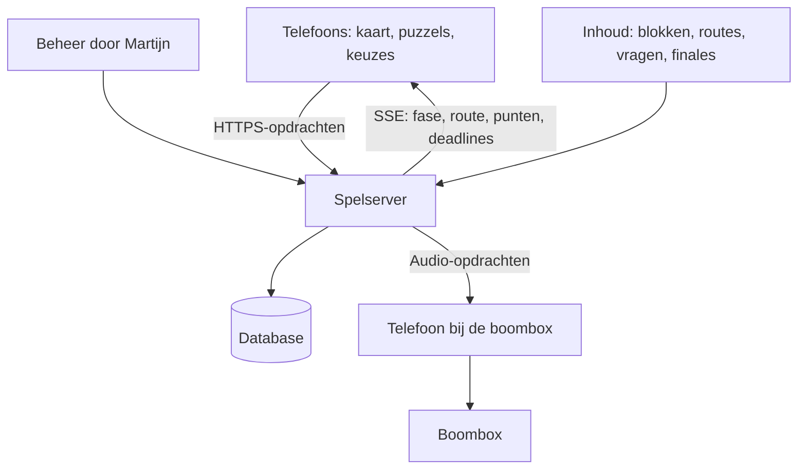

# Architectuurplan — Martijns Knalfestijn

**Status:** ontwerp voor de volgende bouwfase. De huidige repository bevat alleen het zelfstandige prototype, exporthulpmiddelen en tests daarvan. Dit document claimt geen werkende server of hosting.

## 1. Hoofdkeuze

Eén mobiele webapp, één centrale spelserver en één database. De server bepaalt de fase, klok, winnaar, route en score. De telefoons tonen deze toestand en sturen handelingen in. Eén aangewezen telefoon speelt het groepsgeluid af.

Voor de eerste test stellen we een kleine gedeelde TypeScript-codebasis voor:

| Onderdeel | Voorstel | Functie |
| --- | --- | --- |
| Deelnemersinterface | React + TypeScript, gebouwd met Vite | Kaart, poppetjes, puzzels en schermvullende oefeningen |
| Server | Node.js + TypeScript met Fastify | Sessies, opdrachten, toegangscontrole en centrale klok |
| Synchronisatie | HTTPS-opdrachten + Server-Sent Events | Telefoon stuurt een actie; server verspreidt de nieuwe toestand |
| Opslag | SQLite op een blijvend opslagvolume | Deelnemers, rondevoortgang, scores, transacties en deadlines |
| Geluid | Browseraudio op één aangewezen telefoon | Muziek en vooraf vastgelegde aanwijzingen |
| Host | Eén dienst achter HTTPS, met permanente opslag | Website, API en eventstream onder dezelfde oorsprong |

Dit is een projectkeuze om de eerste versie klein te houden, geen claim dat de onderdelen al zijn geïnstalleerd. Kies en leg versies vast tijdens de eerste bouwtaak. Begin met één serverproces. Meerdere servers, horizontaal schalen en externe taakqueues vallen buiten de eerste test. Voor meerdere servers wordt later ook de database- en eventdistributie herzien.

[React](https://react.dev/learn) en [Vite](https://vite.dev/guide/) leveren respectievelijk de componentopbouw en bouwomgeving. [Fastify](https://fastify.dev/docs/latest/Reference/Server/) levert de HTTP-server. [SSE](https://developer.mozilla.org/en-US/docs/Web/API/Server-sent_events/Using_server-sent_events) stuurt gebeurtenissen van server naar browser; handelingen terug naar de server gaan via gewone HTTPS-verzoeken. De keuze voor één SQLite-database past bij één applicatieserver; SQLite heeft grenzen bij veel gelijktijdige schrijvers, dus controleer de voorziene groepsgrootte in een belastingtest. [SQLite-toepassingen en grenzen](https://www.sqlite.org/whentouse.html).



## 2. Grenzen tussen verantwoordelijkheden

**Interface:** tekenen, invoer, geluid en een vloeiend aftellende weergave. Geen punten toekennen, antwoorden valideren of routes autoriseren in de browser. De eigen schermnaam is geen bewijs van identiteit.

**Spelmotor:** onafhankelijke, testbare functies voor geldige acties, routekeuze, puntentoekenning, inventaris en volgende fase. De motor krijgt tijd en sessietoestand als invoer. Hij roept geen browser, database of audioplayer aan.

**Server:** valideert de toegangsrechten, leest tijd en toestand, voert de motor uit en slaat de wijziging in een transactie op. Publiceert pas daarna een event met een oplopende revisie. Verstuurt alleen de informatie die een deelnemer mag zien.

**Inhoudsconfiguratie:** door Martijn vastgestelde oefeningen, vragen, uitspraken en finales. Valideer deze vóór een sessie opent. Gebruik een vastgelegde inhoudsversie per sessie; wijzig een lopende sessie niet stilzwijgend door de configuratie te bewerken.

## 3. Toestand en sessieverloop

```text
lobby → warming_up → initial_vote → exercise
                                 ↗           ↘
                           route_choice ← puzzle

exercise → volgend tijdvak → ... → finale → cooling_down → completed
```

Winkel en sidequest zijn optionele vensters in de route en het tijdschema, geen extra tijd boven op het uur. Een enkele schermwaarde is onvoldoende: puzzel en keuzerecht kunnen tijdelijk tegelijk bestaan. Bewaar daarom apart de hoofdfase, de open puzzel, het keuzerecht en hun deadlines.

Een sessie bewaart minimaal `startedAt`, `endsAt`, `phase`, `phaseEndsAt`, `roundId`, `revision`, `contentVersion` en `audioControllerId`. Het uur stopt op `endsAt`, ongeacht een telefoon die wegvalt of een vraag die niemand oplost.

### Vaste tijdvakken en overlappende keuze

- De groepsstemming kiest het eerste blok.
- Daarna heeft een puzzel een gemeenschappelijke antwoorddeadline na maximaal 60 seconden.
- De eerste juiste oplossing legt de rondewinnaar vast. Die ziet direct twee geldige blokken en krijgt maximaal 30 seconden keuzetijd.
- Anderen mogen tot hun bestaande puzzeldeadline antwoorden; correct geeft ook punten en eventueel een veto.
- De keuze verandert geen deadlines van de overige spelers. Een systeemkeuze bij timeout verlengt evenmin de ronde.
- Oefenen start op het vooraf bepaalde volgende tijdvak. Ongebruikte keuzetijd wordt geplande voorbereiding of herstel, met een korte timer. Geen extra tekst of onbepaald wachten.
- Als niemand wint, kiest de server een geldig blok. Als de winnaar niets kiest, doet de server dat ook; de winnaar blijft dan de voorloper.

Voorstel om door Martijn te laten beoordelen: 8 minuten warming-up, 30 seconden startstemming, 12 blokken van 2 minuten, 11 puzzels van 60 seconden, 11 keuzetijdvakken van 30 seconden, 6 minuten finale en 5 minuten cooling-down. **Totaal 60 minuten.** Aanwijzingen, winkel en sidequests passen binnen die vensters. Deze inhoud moet nog worden vastgesteld.

De server kijkt bij iedere opdracht en periodiek naar verstreken deadlines. Timers in het geheugen dienen alleen om wakker te worden. Bij een herstart reconstrueert de server de actuele fase uit de bewaarde tijdstippen. Achterstallige fases worden verwerkt zonder het einde van het uur op te schuiven.

## 4. Route en trainingsbalans

De spelkaart is een gerichte graaf van knopen en verbindingen. Iedere finale bevat zichtbare inhoud en zichtbaar bereikbare paden. Laat deelnemers een finale bekijken zonder daarmee een keuze te maken. Latere keuzemomenten kunnen de groep nog naar een andere finale sturen, tot een duidelijk gemarkeerde laatste afslag.

Een trainingsblok krijgt onder andere `durationSeconds`, `phase`, `movementPatterns`, `muscleGroups`, `equipment`, `loadClass`, `recoveryClass` en `allowedAlternatives`. De routeplanner combineert deze tags met de al uitgevoerde blokken en resterende tijd.

Bij iedere splitsing biedt de server precies twee geldige, tijdsgelijke opties. De validator controleert dat elke bereikbare vervolgroute past bij de trainingsopbouw, de vooraf vastgestelde belasting en een finale die nog binnen het uur past. Een ongeldige inhoudsconfiguratie mag een sessie niet starten. Bereikbaarheid komt uit de graaf; de interface mag geen niet-bestaande route naar een favoriete finale suggereren.

De groep heeft één positie en één gekozen route. De rondewinnaar staat visueel vooraan; de rest volgt op totaalpunten. De ranglijst bovenaan blijft op totaalpunten gesorteerd. Een persoonlijke oefenwissel wijzigt de groepsroute niet.

## 5. Gegevens en atomaire verwerking

| Gegevens | Belangrijkste inhoud |
| --- | --- |
| Evenement | Openen, inschrijfsluiting, einde deelname en verwijderdatum |
| Sessie | Modus, sessiecode, inhoudsversie, klok, revisie en fase |
| Deelnemer | Anonieme sessie-identiteit, schermnaam en avatar |
| Ronde | Puzzel, antwoorddeadline, winnaar en keuzerecht |
| Inzending/stem | Servervolgorde, ronde, deelnemer, geldigheid en unieke actie-id |
| Punten en munten | Afzonderlijke onveranderlijke boekingen met reden |
| Voorraad en aankoop | Veto's, power-ups, prijs en daadwerkelijke levering |
| Route | Gekozen knopen, bereikbare finales en uitgevoerde trainingsbelasting |
| Sidequestclaim | Deelnemer, ronde, sidequest en toegekende bonus |
| Audioregie | Aangewezen telefoon, lease, cue-id en muziekvolgorde |
| Sessiegebeurtenis | Revisie, type, tijdstip en veilige payload voor hervatting |

Gebruik unieke sleutels voor dubbele inzendingen, bonusclaims en aankopen. Leg het winnen van een ronde vast in dezelfde transactie als de geaccepteerde juiste inzending. Slechts één transactie kan het nog lege winnaarsveld vullen. Hanteer bij gelijktijdigheid één gedocumenteerde servervolgorde; telefoontijd is niet leidend.

Munten uitgeven verlaagt geen totaalpunten. Boek afschrijving en levering van een power-up in één transactie. Een eerder verwerkte actie met dezelfde id levert dezelfde uitkomst op, zonder tweede afschrijving. Er is geen echt geld en geen fysieke prestatiewaarde in de score.

## 6. API en synchronisatie

Voorgestelde contracten, nog niet geïmplementeerd:

```text
POST /api/sessions                         beheer: sessie maken
POST /api/sessions/:code/join              deelnemen met schermnaam
GET  /api/sessions/:id/state               actuele, toegestane snapshot
GET  /api/sessions/:id/events              SSE, met event-id/revisie
POST /api/sessions/:id/start               bevoegd starten
POST /api/sessions/:id/votes               startstemming
POST /api/sessions/:id/rounds/:round/answer puzzelantwoord
POST /api/sessions/:id/rounds/:round/choice routekeuze door winnaar
POST /api/sessions/:id/veto                 toegestane veto-actie
POST /api/sessions/:id/purchases            winkeltransactie
POST /api/sessions/:id/sidequests/:quest     sidequestantwoord
POST /api/sessions/:id/audio/claim          bevoegde audio-overdracht
POST /api/sessions/:id/audio/heartbeat      lease behouden
```

Iedere opdracht bevat een unieke actie-id en de bedoelde ronde of fase. De server weigert verlopen of onbevoegde acties en geeft de actuele revisie terug. Stream bijvoorbeeld `session.updated`, `round.won`, `route.chosen`, `phase.changed`, `score.updated` en `audio.cue`.

Een deelnemer haalt eerst een snapshot op en sluit met de revisie aan op events. Bij een onderbreking: gebeurtenissen sinds de laatste bevestigde revisie ophalen, of een nieuwe snapshot als de historie verlopen is. Verwerk een event niet tweemaal. Toon een duidelijke verbindingsstatus; score geen offline ingestuurde antwoorden alsof ze tijdig waren.

## 7. Geluid en digitale host

De audiofunctie staat los van de puzzels en score. De server stuurt cue-id, bron, starttijd en prioriteit. Slechts de telefoon met een geldige audiolease speelt groepsgeluid. Opdrachten en muziek krijgen een wachtrij; een aankoop kan geen actieve uitleg onderbreken.

Vóór Start: telefoon via de eigen instellingen aan de boombox koppelen, hoorbare test bevestigen en controleren dat het scherm actief blijft. De website claimt geen automatisch beheer van Bluetooth. De daadwerkelijke browser- en geluidsonderbrekingen worden op locatie getest.

De lease voorkomt gelijktijdige geluidstelefoons. Bij uitval kan een bevoegde deelnemer de audio overnemen met een nieuwe lease en actuele cue-snapshot. Scores en het vaste einde van het uur blijven staan. Hervatting mag geen oude cues opnieuw stapelen. De concrete hersteltekst en fallback worden in de repetitie getoetst.

Martijns intro, uitspraken, overgangen en afsluiting zijn vooraf ingestelde tekst, geluid of opnames. De deelnemersapp heeft geen live AI-verbinding met deze chat nodig.

## 8. Toegang en tijdelijke gegevens

Een QR-code opent de juiste sessie. Na een schermnaam krijgt de deelnemer een onvoorspelbare anonieme sessie-identiteit, bij voorkeur via een beveiligde HttpOnly-cookie. Deelnemers kunnen niet via een naam de identiteit van iemand anders overnemen. Beheer en Start/audiotoewijzing vereisen een aparte servermatig gecontroleerde bevoegdheid.

Antwoordsleutels en beheersleutels gaan niet naar de browser. Valideer invoer, oorsprong van schrijfverzoeken, aantallen pogingen en sessiegrenzen. Voorinschrijving per mail staat buiten de app; planned/joined/completed zijn aparte statussen.

De repository is openbaar. Echte deelnemers, omzet, citaten en audiobestanden staan alleen in de afgeschermde runtime-opslag. Servergeheimen komen uit omgevingsvariabelen. Muziek wordt later via de afgesproken bron aangesloten; er staat geen muziekcatalogus in Git.

De server handhaaft openen en sluiten op datum. Verwijderen gebeurt servermatig via een geplande taak of bij de eerstvolgende serverstart, en neemt gekoppelde bestanden en de afgesproken bewaartermijn voor backups mee. Een verborgen websiteknop is geen sluiting of gegevensverwijdering.

## 9. Voorgestelde structuur tijdens de migratie

```text
src/prototype.html          bestaande ontwerpbron behouden
index.html                  bestaande gegenereerde demo behouden
apps/web/                   nieuwe React-interface
apps/server/                API, eventstream, database en audioregie
packages/game/              pure spelregels, timing en routevalidator
packages/contracts/         gedeelde invoer- en eventcontracten
content/examples/           alleen fictieve voorbeeldinhoud
db/migrations/              versiebeheer van de databasestructuur
tests/integration/          meerdere deelnemers, deadlines, transacties
tests/e2e/                  echte browserstromen
```

Deze nieuwe mappen worden pas aangemaakt bij de implementatie. Leg geen tweede complete productlogica in de oude demo vast. Hergebruik vormgeving en beleving; verplaats autoriteit naar de server.

## 10. Bouwvolgorde en gereedcriteria

1. **Gedeelde ronde:** drie telefoons, join, puzzel, winnaar, keuze, oefenblok en automatisch verder. Correcte serverrechten en deadlines.
2. **Herstel:** herladen, netwerkverlies, serverherstart en dubbele acties zonder andere score of extra tijd.
3. **Trainingsroute:** inhoudsvalidatie, zichtbare finales, startstemming en alle mogelijke paden binnen hetzelfde uur.
4. **Host en boombox:** één geluidstelefoon, vooraf vastgelegde cues en aantoonbare overdracht.
5. **Winkel en sidequest:** koop levert daadwerkelijk de beloofde actie, bonus kan niet onbeperkt opnieuw worden geclaimd.
6. **Repetitie:** volledig uur op locatie, inclusief geen-goed-antwoord-pad. Martijn hoeft niet mondeling bij te sturen.

De testplanning staat in `STAPPENPLAN.md`. De solomodus gebruikt dezelfde servermotor met één deelnemer; bouw geen tweede afwijkende klok of puntentelling.
